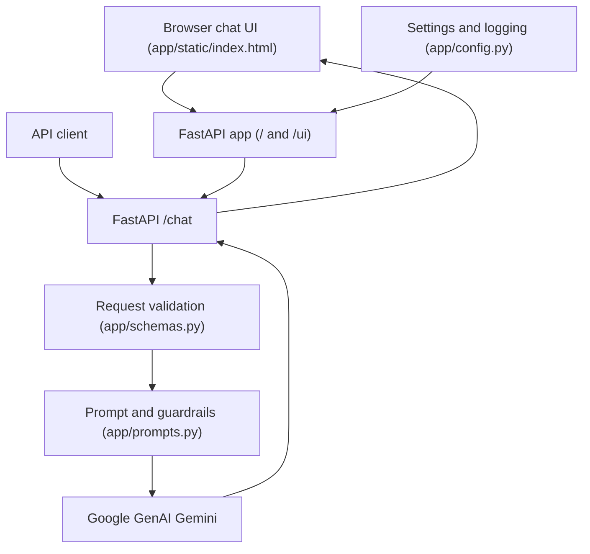
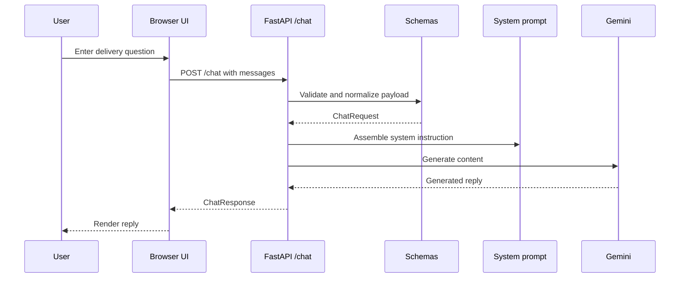

# Nova Support

Nova Support is a FastAPI customer-support assistant for delivery, shipping,
tracking, and refund questions. The current implementation is **v0.1**:
Google GenAI inference, a system prompt with a static micro-FAQ, request
validation, structured backend logging, and a browser chat UI are implemented.
RAG, MCP tools, RBAC, semantic routing/caching, and evaluation workflows are
planned.

## System Design





## Project Structure

```text
├── .env.example
├── .github/
│   └── copilot-instructions.md
├── app/
│   ├── __init__.py
│   ├── config.py
│   ├── main.py
│   ├── prompts.py
│   ├── schemas.py
│   └── static/
│       └── index.html
├── pyproject.toml
├── README.md
└── uv.lock
```

- `app/config.py`: Loads environment settings and configures logging.
- `app/main.py`: Defines the FastAPI application, `/`, `/ui`, `/health`, and
  `/chat` endpoints, plus the Gemini client integration.
- `app/prompts.py`: Defines Nova's scope, loyalty rule, policies, and guardrails.
- `app/schemas.py`: Defines and normalizes chat and health request/response
  models.
- `app/static/index.html`: Browser chat client for the local API.
- `.github/copilot-instructions.md`: Repository guidance; the only application
  package is the root `app/` directory. Do not recreate `backend/`.

## Local Setup and Runbook

Use `uv` for environment and dependency management:

```bash
cp .env.example .env
# Set GEMINI_API_KEY in .env
uv sync
uv run uvicorn app.main:app --reload
```

Open `http://localhost:8000` for the browser chat UI. Swagger documentation is
available at `http://localhost:8000/docs`.

Run the test suite with:

```bash
uv run pytest
```

Run the live FAQ and guardrail regression checks against a running server with:

```bash
uv run python tests/test_nova.py
```

## API Contract and Design Decisions

- `GET /`: Serves the browser UI for HTML clients or service metadata for JSON
  clients.
- `GET /ui`: Serves the browser UI explicitly.
- `GET /health`: Returns `status`, `app_name`, and `environment`.
- `POST /chat`: Accepts `{"messages": [{"role": "user", "content": "..."}]}`.
  Legacy `message` and `history` fields are normalized by `ChatRequest`.
  Responses are `{"reply": "..."}`.
- The system prompt limits answers to delivery and shipping support, prevents
  competitor promotion, and enforces the static shipping, operating-hours,
  damaged-parcel, and lost-parcel policies.
- Startup configuration, request counts, LLM latency, and failures are logged
  without logging API keys. Missing configuration and provider failures return
  explicit HTTP errors.

## Advancements

### 2026-11-12

- **What changed:** Consolidated the implementation and browser UI into the
  root `app/` package, removed the duplicate `backend/` tree, and updated
  startup documentation and the module execution target.
- **Why it changed:** Ensures imports, static assets, and the documented
  `uv run uvicorn app.main:app --reload` command all use one application
  location.
- **Next planned layer:** Add retrieval-backed knowledge and tool integrations
  without introducing a second application package.
